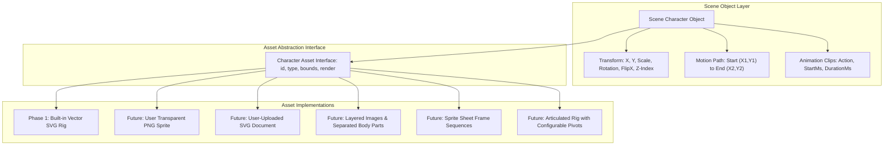
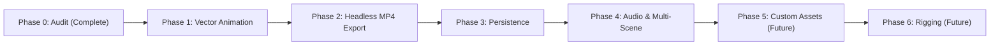

# AI Media Studio — 2D Animation Editor Roadmap

## 1. Project Vision & Goals

AI Media Studio is an existing full-stack web application designed for creating stories and multimedia content. The project already contains comprehensive editor screens and media workflows, including story and scene management, character creation, narration voice generation, a multi-track timeline, and video assembly pipelines.

The objective of this project is **not to build a secondary editor, demo page, or separate application**. The goal is to evolve the existing editor in place into a production-grade 2D animation studio that can produce animated videos without depending on external AI video-generation models.

### Core Architectural Pillars
- **Deterministic 2D Animation:** Motion is generated using code-driven parametric kinematics evaluated mathematically against timeline timestamps.
- **Vector-First Character Architecture:** Characters are initially constructed from modular SVG body parts with defined rotational pivot anchors.
- **Format-Agnostic Asset Abstraction:** The scene and animation engine decouple object transforms and motion paths from the underlying asset format, allowing future support for custom PNG/SVG graphics, layered cutouts, and sprite sheets.
- **In-Place Editor Evolution:** All upgrades are integrated directly into the existing full-page editor (`StoryDetailPage.tsx`), preserving the dark navy design system, existing project data, and working integrations.
- **Direct Backend MP4 Rendering:** Renders 1280x720 30 FPS MP4 video segments by piping headless frames directly into FFmpeg (`image2pipe`), eliminating heavy browser automation while multiplexing scene narration and background music.
- **Optional AI Tooling:** Existing AI story, image, and voice capabilities are preserved as complementary asset-creation tools rather than mandatory runtime dependencies.

The initial milestone proves one complete workflow: **one background image + one vector character + animation (walking in-place or along a motion path, waving) + deterministic timeline preview + persistent save + real MP4 export.**

---

## 2. Non-Negotiable Requirements

1. **In-Place Editor Upgrade:** Modify the existing application and editor in place. Do not create a separate editor application, duplicate editor route, demo screen, or disconnected storyboard.
2. **Repository-Grounded Implementation:** Inspect the actual codebase before proposing or modifying files. Base all architectural decisions strictly on verified code, models, and dependencies.
3. **Data & Workflow Preservation:** Preserve existing stories, characters, scenes, generated media files, and working backend services. Do not break or discard existing user projects.
4. **Visual Consistency:** Retain the editor's dark navy, blue, and purple design system (`#090d16`, `#111827`, `#1e293b`, `#3b82f6`). Ensure all existing and extended screens remain visually cohesive.
5. **Functional Integrity:** Implement genuine functionality behind every visible control. Placeholder handlers, simulated progress, fake media URLs, and mock exports are strictly prohibited.
6. **Physical Honesty in Media:**
   - Clearly distinguish still images, Ken Burns pan/zoom clips, AI video clips, and true 2D character animation.
   - For a single flat image (PNG or static SVG), support spatial transforms and holistic movement (translation, scaling, rotation, bobbing, shake). Never simulate fake limb bending or pretend a flat raster image has articulated joints.
7. **Preview-to-Export Determinism:** The in-browser preview and backend export pipeline must evaluate the exact same scene model, kinematic functions, and timeline offsets so the exported MP4 visually matches the canvas preview.
8. **Truthful Status Reporting:** Distinguish existing verified code, unverified services requiring external credentials, proposed Phase 1 enhancements, and future roadmap items.

---

## 3. Project Setup & Local Development

### Prerequisites
- Node.js (v18+ recommended)
- PostgreSQL database instance
- FFmpeg (bundled via `@ffmpeg-installer/ffmpeg` in backend)

### Backend Setup
```bash
cd backend
npm install
# Set up environment variables in .env (DATABASE_URL, PORT, etc.)
npx prisma generate
npm run dev
```
- **Default Port:** `http://localhost:5001`
- **Test Suite:** `npm test` (Executes unit and integration tests)

### Frontend Setup
```bash
cd frontend
npm install
npm run dev
```
- **Default Port:** `http://localhost:5173`
- **Type Check & Build:** `npm run build` (`tsc -b && vite build`)

---

## 4. Current Product Context & Feature Status

All capabilities in this repository are categorized into four explicit architectural states:

| Category | Features & Components | Repository Evidence | Status |
| :--- | :--- | :--- | :--- |
| **A. Existing Verified Functionality** | Full-page editor workspace | `frontend/src/pages/StoryDetailPage.tsx` | Operational |
| | Dark navy theme & design tokens | `frontend/src/styles/globals.css`, `editor.css` | Operational |
| | Story, Scene, and Version CRUD | `backend/src/routes/content.ts`, `database.service.ts` | Operational |
| | PostgreSQL Schema | `backend/prisma/schema.prisma` (`Story`, `Scene`, `Character`) | Operational |
| | TTS Narration Audio Generation | `backend/src/services/audio-generation/`, `google-tts-api` | Operational |
| | Still-to-Video Ken Burns Rendering | `backend/src/services/production/video-generation/providers/ffmpeg-video.provider.ts` | Operational |
| | Full-Movie FFmpeg Assembly | `backend/src/services/video-assembly/video-assembly.service.ts` | Operational |
| | Automated Backend Test Suite | `backend/tests/` (11 passing tests) | Operational |
| **B. Existing Requiring Verification** | External AI Image Generation | HuggingFace, Pollinations, ComfyUI providers | Requires API keys / local service |
| | External AI Video Generation | Runway, Luma, Replicate provider interfaces | Requires external credentials |
| | YouTube Publisher Module | Stubbed API integration | Unverified |
| **C. Proposed Phase 1 Enhancements** | Character Asset Abstraction | `frontend/src/types/animation.ts` (Proposed) | Ready for implementation |
| | Built-in Vector Character Rig | Modular SVG templates (e.g., "Pip the Bear") | Ready for implementation |
| | Interactive Canvas Transform Gizmo | Selection, movement, scale, rotation, flip on canvas | Ready for implementation |
| | Deterministic Kinematic Engine | `idle`, `walk` (in-place & motion path), `wave`, `jump` | Ready for implementation |
| | Timeline Animation Sub-Tracks | Visual clip blocks with start/duration drag handles | Ready for implementation |
| | Non-Destructive Persistence | `animationData Json?` field on `Scene` model | Ready for migration |
| | Headless Backend Video Rendering | Node.js SVG evaluator + FFmpeg `image2pipe` stream | Ready for implementation |
| **D. Future Capabilities (Phase 5+)** | Custom PNG/SVG Character Uploads | Upload & drag-to-canvas workflow | Future Phase |
| | Flat Image Motion Effects | Holistic translation, rotation, bobbing, squash/stretch | Future Phase |
| | Layered Artwork Cutouts | Multi-part image cutouts (`torso.png`, `head.png`) | Future Phase |
| | Articulated Skeletal Rigging | Configurable pivot anchors & sprite sheet sequences | Future Phase |

---

## 5. Product Scope

### In Scope for Phase 1 (Vector Character Milestone)
- Upgrade the existing editor in place (`frontend/src/pages/StoryDetailPage.tsx`).
- Introduce format-agnostic character asset abstraction data contracts.
- Implement built-in modular vector character rigs (SVG shapes with defined joint pivots).
- Compose scenes from background images + vector character instances.
- Position, scale, rotate, flip horizontally, and layer characters on the 16:9 canvas using interactive handles.
- Support deterministic kinematic animation actions: `idle`, `walk`, `wave`, and `jump`.
- Support dual walking modes: **in-place** (stationary cycle) and **start-to-end motion paths** ($(X_1, Y_1) \to (X_2, Y_2)$).
- Add character animation sub-tracks to the existing timeline with start/duration handles.
- Real-time hardware-accelerated preview and playhead scrubbing in the browser.
- Persist `animationData` to the database and restore all composition properties on reload.
- Render genuine 1280x720 30 FPS MP4 video segments via backend FFmpeg pipe with synchronized narration speech.
- Preserve all working AI image generation, Ken Burns rendering, audio controls, and editor themes.

### Out of Scope for Phase 1 (Deferred to Future Phases)
- User-facing custom image uploaders and sprite-sheet slicers.
- Visual character rigging editors and joint weight painting.
- 3D skeletal meshes or complex inverse kinematics (IK).
- Phoneme-perfect automated lip synchronization.
- Freehand in-browser vector drawing tools.
- Mandatory external AI video generation APIs for character motion.

---

## 6. User Workflows

### A. Phase 1 Milestone Workflow (Vector Character Animation)
The primary implementation target proves that one background, one vector character, an animation, and a real MP4 export work together end to end:

1. **Open Existing Project:** Open an existing story in the current editor (`/story/:storyId`).
2. **Select Scene & Background:** Open an existing scene and select a background image (or generate one via AI image tools).
3. **Add Built-in Vector Character:** Select a pre-rigged vector character (e.g., "Pip the Bear") from the asset panel; instantiate it onto the scene canvas.
4. **Position & Transform:** Move $(X, Y)$, scale, rotate, flip horizontally, and adjust layer stacking (`zIndex`) using interactive canvas handles.
5. **Apply Animation Clip:** Choose an animation action:
   - `idle`: subtle breathing and blinking.
   - `walk`: choose between **in-place** (stationary treadmill at fixed coordinates) or **motion path** (animates linearly from $(X_1, Y_1)$ to $(X_2, Y_2)$).
   - `wave`: articulated arm oscillation about shoulder and elbow pivots.
   - `jump`: vertical parabolic displacement with landing squash.
6. **Set Timeline Timing:** Adjust the animation clip's start time and duration on the timeline sub-track.
7. **Scrub & Playback:** Scrub the playhead to verify deterministic, smooth pose evaluation at any millisecond timestamp.
8. **Save & Reopen:** Persist project changes to PostgreSQL (`animationData`); reload the page to confirm full state restoration.
9. **Export Real MP4:** Trigger video export; the backend renders 30 FPS frames via FFmpeg pipe and multiplexes narration speech and background music into a genuine 720p MP4.

### B. Future Drag-and-Drop Custom Character Workflow (Phase 5+)
In future phases, the workflow expands to user-provided assets without changing the editor structure:

1. **Asset Upload/Selection:** User uploads an image (transparent PNG or SVG) or selects an existing asset in the asset panel.
2. **Drag onto Canvas:** User drags the character asset directly from the asset drawer and drops it onto the 16:9 canvas.
3. **Scene Object Instantiation:** The dropped asset immediately becomes a scene object with initialized coordinates, default scale, and bounding box.
4. **Transform & Pathing:** User moves, resizes, rotates, layers, and defines multi-point animation paths across the background.
5. **Animation Clip Assignment:** User assigns clips appropriate for the asset type (flat image motion effects vs. articulated rig actions) and arranges them on the timeline.
6. **Preview & Verification:** Canvas displays real-time motion pathing and sprite animations.
7. **Production Export:** Headless renderer produces the final assembled MP4.

---

## 7. Editor Workspace & Interaction Architecture

The existing editor is the visual and structural foundation. It is upgraded in place without creating separate editor routes:

### Top Toolbar
- **Project Context:** Story title, back navigation, and last-saved timestamp.
- **History Controls:** Undo and redo for scene composition and transform edits.
- **Save Status Indicator:** Real-time badge showing `saved`, `saving`, `dirty`, or `error`.
- **Timecode Display:** Current playhead time and total project duration (`00:00.00 / 00:30.00`).
- **Transport Controls:** Play/Pause button and spacebar keyboard shortcut.
- **Preview Mode Toggle:** Switch between active scene preview and assembled movie preview.
- **Export Action:** Triggers full-movie export modal with live progress updates.

### Left Asset Panel
- **Characters Tab:** Pre-rigged vector character library (Phase 1) and user character assets. Serves as the source for adding characters to scenes.
- **Backgrounds & Images Tab:** Scene backgrounds generated via AI or uploaded by user.
- **Props Tab:** Stationary and animated accessory items (future).
- **Clips & Videos Tab:** Pre-rendered Ken Burns or AI video clips.
- **Narration/Audio Tab:** Per-scene speech generation with voice picker and regeneration controls.
- **Soundtrack Tab:** Background music selection, track preview, and volume mix controls.

### Center Canvas / Preview Viewport
- **Standardized Coordinate Space:** Fixed 16:9 aspect ratio (`1280x720` coordinate space).
- **Multi-Layer Rendering:** Composites the background image at the base layer, followed by stacked scene objects sorted by `zIndex`.
- **Interactive Transform Gizmo:** Bounding box with corner scale handles, top rotation handle, and drag-to-position behavior.
- **Drop Target Surface:** Canvas accepts drag-and-drop events from the asset panel to instantiate objects at cursor position.
- **Real-Time Playhead Synchronization:** SVG transforms and joint angles recompute smoothly on playhead scrub with 60 FPS hardware acceleration.
- **Video Fallback:** Renders native `<video>` element when viewing pre-rendered MP4 clips or full-movie exports.

### Right Inspector
Properties dynamically adapt based on current selection:

**For a Character Instance:**
- Identity: Character name, asset type, and instance identifier.
- Spatial Transforms: Coordinates $(X, Y)$, uniform scale, rotation angle $(-180^\circ \text{ to } +180^\circ)$, and horizontal flip (`flipX`).
- Layering: Visual stacking order (`Bring to Front`, `Send to Back`, `Step Forward/Backward`).
- Animation Action: Action selector (`idle`, `walk`, `wave`, `jump`).
- Walk Movement Mode: Toggle between `In-Place` and `Motion Path`.
  - For *Motion Path*: Start coordinates $(X_1, Y_1)$ and End coordinates $(X_2, Y_2)$ with visual trajectory on canvas.
- Timing Parameters: Start offset (ms), duration (ms), loop toggle, and speed multiplier ($0.5\times$ to $2.0\times$).

**For the Scene / Background:**
- Background image preview, prompt override, and AI image regeneration.
- Scene duration override, timing bounds, and transition settings.

**For Scene Narration Audio:**
- Audio playback waveform, scrubber, and detected speech duration.
- Voice regeneration, volume slider, and audio removal controls.
- Enforced layout constraints (`min-width: 0`, flexbox containment) to eliminate horizontal panel overflow.

### Bottom Timeline
- **Visual Track:** Displays contiguous scene blocks with thumbnail previews.
- **Character Animation Sub-Tracks:** Expandable lanes below the scene block displaying individual character animation clips with draggable start and duration handles.
- **Narration Audio Track:** Visualizes speech duration relative to scene length.
- **Soundtrack / Music Track:** Visualizes background music waveform and loop boundaries.
- **Time Ruler & Playhead:** Click-to-scrub and drag-to-scrub synchronized with canvas pose evaluation.
- **Timeline Editing Tools:** Zoom in/out/fit, split scene at playhead, duplicate scene, and ripple edit.
- **Timing Warnings:** Visual alerts when scene duration is shorter than narration speech.

---

## 8. Character Asset Abstraction & Rig Architecture

### Format-Agnostic Asset Abstraction
The scene composition and animation engine are **not tightly coupled to SVG-specific character definitions**. Rendering and animation capabilities are separated from the underlying character asset format:



### Supported Character Formats Across Phases
1. **Built-in Vector Characters (Phase 1):** Modular SVG shapes with defined rotational pivot anchors $(P_x, P_y)$, animated via kinematic joint angles.
2. **User-Uploaded Transparent PNG Characters (Future):** Flat single-image raster sprites for quick imports.
3. **User-Uploaded SVG Characters (Future):** Single-file vector graphics rendered directly into the viewport.
4. **Layered Character Images & Separated Body Parts (Future):** Modular cutouts (`torso.png`, `head.png`, `arm.png`) articulated using the same joint-rotation logic as vector rigs.
5. **Sprite Sheets & Frame Sequences (Future):** Grid-based raster sprite sheets cycling through frame indices based on timestamp.
6. **Articulated Rigs with Configurable Pivots (Future):** Advanced skeletal rigs with visual pivot editors.

### Physical Honesty in Character Motion
- **Single Flat Image (PNG or static SVG):** Supports spatial translation, scaling, rotation, horizontal flip, and holistic motion effects (bobbing, bouncing displacement, gentle rocking, squash/stretch, or shaking). **It never simulates fake limb bending or phantom joint articulation.**
- **Articulated Character Animation:** True limb articulation strictly requires segmented body parts—either via Phase 1 modular SVG rigs, future layered multi-image assemblies, or future sprite sheets.

### Architectural Decisions for Phase 1
- `CharacterInstance` includes an `assetType` tag (`'vector_rig' | 'image' | 'svg' | 'layered' | 'spritesheet'`) and generic bounding dimensions.
- Coordinate placement, scaling, layer ordering, and motion path interpolation are asset-agnostic.
- Limb rendering is delegated to renderer adapters: Phase 1 implements `VectorCharacterRenderer`, leaving the interface ready for `ImageCharacterRenderer` and `SpriteSheetRenderer` in later phases.

---

## 9. Proposed Animation Engine & Motion Model

The animation engine operates as a **deterministic, time-based mathematical function**. Output transforms and poses depend strictly on the requested scene timestamp $t$, with zero reliance on browser animation accumulators or non-reproducible CSS transitions:

$$\text{Pose}(t) = f\left(\text{AssetType}, \text{RigDefinition}, \text{Clips}, t - \text{scene.startMs}\right)$$

### Dual Walking Modes
1. **In-Place Walking (Treadmill Style):**
   - Character stays at fixed $(X, Y)$ canvas coordinates.
   - Legs and arms cycle through alternating sinusoidal angles.
   - Torso exhibits subtle vertical bouncing $Y_{\text{bob}}(t) = -8 \cdot |\sin(2\pi f t)|$.
   - Suitable for stationary shots, comedic conveyor-belt gags, or moving Ken Burns backgrounds.

2. **Motion Path Walking (Start-to-End Translation):**
   - Character translates smoothly across the canvas from start coordinates $(X_1, Y_1)$ to end coordinates $(X_2, Y_2)$ over clip duration $[T_{\text{start}}, T_{\text{end}}]$.
   - Positional interpolation:
     $$X(t) = X_1 + (X_2 - X_1) \cdot \frac{t - T_{\text{start}}}{T_{\text{end}} - T_{\text{start}}}$$
     $$Y(t) = Y_1 + (Y_2 - Y_1) \cdot \frac{t - T_{\text{start}}}{T_{\text{end}} - T_{\text{start}}}$$
   - Leg stride frequency is synchronized with translation velocity so the character does not visually slip across the ground.
   - Directional auto-flip: Automatically flips `flipX` based on translation direction ($X_2 > X_1$ faces right, $X_2 < X_1$ faces left), with manual override.

### Standard Animation Actions (Phase 1)
- **`idle`:** Gentle breathing chest scale ($1.00 \to 1.02$) and head tilt ($\pm 2^\circ$).
- **`walk`:** Alternating leg swings ($\pm 28^\circ$), arm counter-swings ($\mp 20^\circ$), vertical bob, and optional motion path translation.
- **`wave`:** Right arm raised to $-135^\circ$ with forearm and wrist oscillating rapidly ($3.0\text{ Hz}$).
- **`jump`:** Vertical parabolic curve $Y(t) = 4h \cdot \frac{t}{T} \cdot (1 - \frac{t}{T})$ with pre-jump crouch and landing squash.

### Conceptual Data Contracts
```typescript
export type CharacterAssetType =
  | 'vector_rig'      // Phase 1: Modular SVG rig
  | 'image'           // Future: Flat transparent PNG
  | 'svg'             // Future: Static SVG
  | 'layered'         // Future: Multi-part image cutouts
  | 'spritesheet';    // Future: Frame sequence

export interface MotionPath {
  startX: number;
  startY: number;
  endX: number;
  endY: number;
  easing?: 'linear' | 'easeInOut' | 'easeIn' | 'easeOut';
}

export interface CharacterInstance {
  instanceId: string;
  characterId: string;
  assetType: CharacterAssetType;
  x: number;
  y: number;
  scale: number;
  rotation: number;
  flipX: boolean;
  zIndex: number;
}

export interface AnimationClip {
  clipId: string;
  instanceId: string;
  action: 'idle' | 'walk' | 'wave' | 'jump';
  startMs: number;
  durationMs: number;
  loop: boolean;
  speedMultiplier?: number;
  motionMode?: 'in_place' | 'motion_path';
  motionPath?: MotionPath;
}

export interface VectorSceneData {
  version: 1;
  viewport: { width: 1280; height: 720 };
  background: {
    imageUrl: string;
    fit: 'cover' | 'contain';
  };
  characterInstances: CharacterInstance[];
  animationClips: AnimationClip[];
}
```

---

## 10. Proposed Video Rendering & Headless Export Pipeline

The browser preview and backend export consume the exact same scene definition and deterministic animation rules.

### Headless Backend Pipeline
1. **Job Initialization:** Client requests export via `POST /api/production/story/:storyId/export`. The server creates an `ExportJob` with status `queued` and returns immediately.
2. **Scene Frame Evaluation:** For each scene containing `animationData`, the Node.js rendering engine evaluates character poses and motion paths at discrete 30 FPS intervals: $t_k = k / 30$.
3. **FFmpeg Streaming:** SVG/PNG frames are streamed directly into FFmpeg `stdin` (`image2pipe`):
   ```bash
   ffmpeg -y \
     -f image2pipe \
     -vcodec png \
     -r 30 \
     -i - \
     -i scene-narration.mp3 \
     -c:v libx264 \
     -pix_fmt yuv420p \
     -c:a aac \
     -b:a 192k \
     -shortest \
     scene-segment.mp4
   ```
4. **Assembly & Soundtrack Mix:** The generated scene MP4 segments are concatenated via the FFmpeg `concat` demuxer and mixed with background music (`amix`) by `VideoAssemblyService`.
5. **Output Verification:** Job marks `completed` only when the output MP4 exists on disk with non-zero size, valid video/audio streams, and successful exit code.

### Target Video Specifications
- **Container:** MP4
- **Video Codec:** H.264 (`libx264`, `yuv420p`)
- **Resolution:** 1280 × 720 (720p) / 1920 × 1080 (1080p)
- **Frame Rate:** 30 FPS
- **Audio Codec:** AAC (192 kbps, stereo)

---

## 11. Audio Integration & Timeline Synchronization

- **Narration Synchronization:** Speech generated via `google-tts-api` is attached to the scene, and its duration (`actualAudioDurationMs`) defines the minimum scene length on the timeline.
- **Audio Trimming & Offsets:** Timeline audio tracks display speech start offsets and waveform durations.
- **Background Music Mixing:** Background soundtrack volume is mixed with narration audio during final export using the FFmpeg `amix` audio filter.
- **Inspector Layout Containment:** Audio players and controls are styled with strict width boundaries to prevent panel overflow.

---

## 12. Existing AI Media Integration & Boundary

- **Image Generation:** AI image providers (HuggingFace, Pollinations, ComfyUI) produce still images that serve as scene background scenery.
- **Ken Burns Still-to-Video:** When a scene has a still image and no vector animation, `FFmpegVideoProvider` can render an MP4 clip with a pan/zoom effect.
- **AI Video Providers:** External AI video services remain optional alternatives for cinematic shots.
- **Boundary:** A provider that only produces still images is never represented as an animation generator. Vector animation operates 100% locally and deterministically without external API costs.

---

## 13. Theme, Design System & UI Consistency

- **Design System:** Dark navy theme (`--ed-bg: #090d16`, `--ed-surface: #111827`, `--ed-surface-elevated: #1e293b`) with blue (`#3b82f6`) and purple accents.
- **Light Theme Support:** Documented data-theme tokens (`data-theme="light"`) allow smooth theme toggling while preserving high contrast.
- **Layout Robustness:** Controls fit inside their allocated workspace without clipping or horizontal overflow. Vertical scrolling is contained within individual panels.

---

## 14. Implementation Roadmap & Acceptance Criteria



### Phase 0 — Repository Audit & Architecture Mapping (Complete)
- **Scope:** Complete inspection of frontend routes, components, database schema, and FFmpeg services.
- **Deliverable:** Audit artifact `phase_0_2d_animation_studio_audit_and_plan.md` documenting file maps and non-destructive schema additions.
- **Exit Criteria:** Complete repository audit delivered with zero breaking changes or unverified assumptions.

### Phase 1 — Vector Character Animation & Motion Paths (Planned Milestone)
- **Scope:** Upgrade editor in place (`StoryDetailPage.tsx`). Add 16:9 canvas with background image + 1 built-in vector character. Implement canvas transform gizmo, deterministic kinematics (`idle`, `walk`, `wave`, `jump`), dual walking modes (in-place and motion paths), and timeline animation sub-tracks.
- **Exit Criteria:** Character can be positioned, scaled, flipped, and scrubbed smoothly on the timeline in both walking modes without AI video models.

### Phase 2 — Real Headless MP4 Export via FFmpeg (Planned)
- **Scope:** Implement Node.js headless frame evaluator and FFmpeg `image2pipe` stream in `VideoAssemblyService`. Multiplex scene narration audio with video stream.
- **Exit Criteria:** Backend renders a genuine 1280x720 30 FPS MP4 file that visually matches the canvas preview.

### Phase 3 — Non-Destructive Persistence & State Recovery (Planned)
- **Scope:** Add `animationData Json?` to `Scene` model in PostgreSQL. Implement autosave and restore character instances, coordinates, and clip timing on project reload.
- **Exit Criteria:** Reloading or reopening a project restores the exact composition, transforms, and animation clips.

### Phase 4 — Audio & Multi-Scene Film Assembly (Planned)
- **Scope:** Combine animated vector scenes with image and video scenes in multi-scene timelines. Mix background soundtrack and narration audio.
- **Exit Criteria:** Multi-scene projects export into a single continuous MP4 movie with balanced audio streams.

### Phase 5 — Future: Custom PNG/SVG Characters & Drag-and-Drop (Future)
- **Scope:** User-uploaded transparent PNG and SVG characters. Drag-and-drop from left drawer onto canvas. Flat image motion effects (movement along paths, scaling, rotation, bobbing, shake; zero fake limb articulation).
- **Exit Criteria:** Users can drag custom images onto canvas, set motion paths, and export without modifying the core engine.

### Phase 6 — Future: Layered Artwork, Articulated Rigging & Sprite Sheets (Future)
- **Scope:** Multi-part image cutouts (`torso.png`, `head.png`), configurable pivot anchors, and sprite sheet frame sequences.
- **Exit Criteria:** Hand-drawn raster cutouts and sprite sheets articulate with full skeletal motion.

---

## 15. Testing Strategy & Definition of Done

### Verification Matrix
1. **Project Loading:** Existing stories and scenes open in the current editor without layout regressions.
2. **Background Selection:** Background image displays in the 16:9 canvas at correct aspect ratio.
3. **Character Instantiation:** Adding a vector character places it on canvas with visible transform handles.
4. **Interactive Manipulation:** Dragging moves $(X, Y)$, corner handle scales, rotation handle rotates, and flip button flips horizontally.
5. **Animation Assignment:** User can assign `idle`, `walk`, `wave`, or `jump` clips to the character.
6. **In-Place Walk Test:** In-place walk executes limb cycles while character stays at fixed $(X, Y)$.
7. **Motion Path Walk Test:** Motion path walk translates character from $(X_1, Y_1)$ to $(X_2, Y_2)$ over clip duration with synchronized foot stride rate.
8. **Timeline Scrubbing:** Scrubbing the playhead calculates the exact deterministic pose at selected timestamps.
9. **Persistence & Reload:** Saving project and refreshing browser restores character position, scale, flip, and animation clips.
10. **Headless MP4 Export:** Export generates a genuine 1280x720 30 FPS MP4 file verified via `ffprobe`.
11. **Audio Synchronization:** Narration voice and background music play concurrently in preview and are multiplexed into export.
12. **Asset Abstraction Isolation:** Scene and timeline logic remain decoupled from vector SVG specifics, ensuring readiness for future image assets.
13. **Flat Image Constraint Verification:** Flat single-image assets receive holistic spatial movement and never simulate phantom limb articulation.
14. **Existing Workflow Preservation:** AI image generation, Ken Burns rendering, and existing CRUD actions continue to function without errors.
15. **Layout & Theme Integrity:** Dark navy theme is preserved; right inspector controls do not overflow horizontally.

### Single Definition of Done
The initial milestone is complete only when a user can open an existing project in the current editor, compose a scene with a background and a vector character, configure walking (both in-place and along a motion path) or waving on the timeline, preview it smoothly via playhead scrubbing, save and reopen the project, and export a real 720p 30 FPS MP4 video that visually matches the preview and includes synchronized narration audio.

---

## 16. Guidelines for AI Coding Agents

1. **Read this README first:** Understand the architecture, phase boundaries, and non-negotiable requirements before making changes.
2. **Inspect the actual repository:** Never guess file paths or component names. Inspect code and verify behavior before proposing changes.
3. **Upgrade the existing editor in place:** Never create a secondary editor application, duplicate editor route, or demo screen.
4. **Preserve existing functionality:** Do not break existing stories, scenes, characters, AI image generation, Ken Burns clips, or TTS audio.
5. **Decouple asset formats from scene logic:** Keep `CharacterInstance` and animation pathing format-agnostic so custom image characters can be supported seamlessly in future phases.
6. **Maintain physical honesty in animation:** Single flat images move holistically; only segmented or rigged characters articulate limbs.
7. **Support dual walking modes:** Ensure walking supports both in-place treadmill cycles and start-to-end motion paths.
8. **Implement real functionality:** Every visible control must perform its advertised action. Do not leave mock handlers, fake progress bars, or hardcoded URLs.
9. **Run verification after edits:** Execute type checks (`npm run build` in `frontend`) and backend tests (`npm test` in `backend`) after code modifications.
10. **Report truthfully:** Explicitly list verified features, actual test results, and any unverified items or missing credentials.

---

## 17. Key Architectural Decisions

1. **Deterministic 2D Animation First:** Establish a rock-solid, observable milestone—one background + one vector character + timed animation clips (in-place and motion paths) + persistent save + real MP4 export—before expanding into full rigging editors or external marketplaces.
2. **Format-Agnostic Asset Abstraction:** Keep scene composition, transform gizmos, and timeline tracks agnostic of whether the character is a built-in vector rig, user PNG, user SVG, or sprite sheet.
3. **Physical Honesty in Rendering:** Never pretend flat single-image characters have articulating joints. Flat images move, rotate, scale, and bounce; articulated motion requires segmented vector or raster body parts.
4. **Native SVG Canvas (Zero Bundle Bloat):** Use standard React SVG elements in `PreviewCanvas.tsx` for 60 FPS hardware-accelerated preview and playhead scrubbing without heavy external canvas/WebGL dependencies.
5. **Headless MP4 Generation via FFmpeg Pipe:** Evaluate frames in Node.js and pipe directly into FFmpeg `stdin` (`image2pipe`), eliminating heavy browser automation (Puppeteer) while reusing the existing `VideoAssemblyService`.
